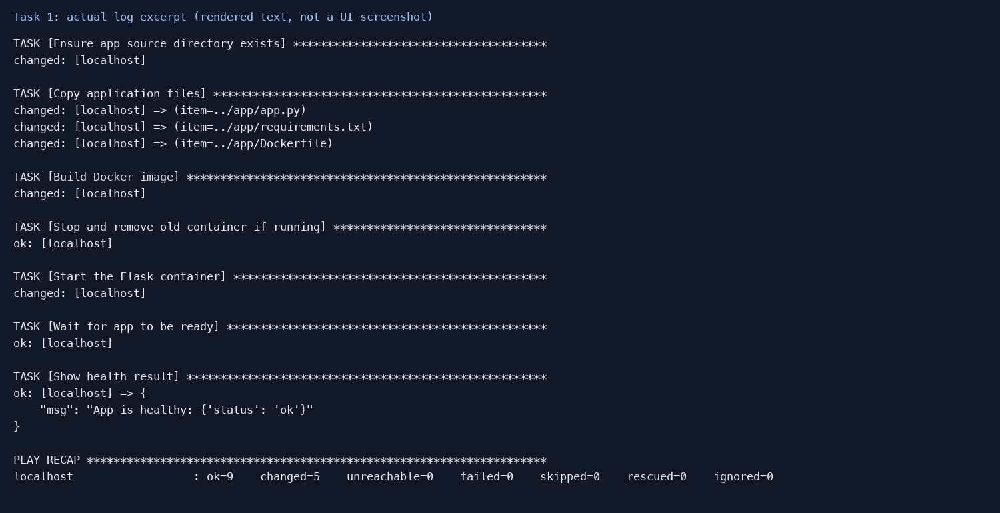

# Lab 3: Monitoring, Logging & DevSecOps

## Task 1: Automate application deployment with Ansible

Nirdesh Jain | Repository: github.com/jainnirdesh/DevOps | 18 November 2026

Platform: macOS (Apple Silicon), Docker context `colima-lab2`, shared network `lab3-network`. Commands below run from the `Lab 3` directory unless stated otherwise. Results describe the saved local execution on 18 November 2026.

## 1. Objective

Build and deploy the Flask application with an Ansible playbook, then verify its HTTP health endpoint.

## 2. Prepare the tools and inventory

```sh
python3 -m venv .venv
.venv/bin/pip install -r requirements-tools.txt
.venv/bin/ansible-galaxy collection install community.docker
export DOCKER_CONTEXT=colima-lab2
export DOCKER_HOST="$(docker context inspect --format '{{.Endpoints.docker.Host}}')"
```

Inventory: [ansible/inventory](../ansible/inventory).

```ini
[local]
localhost ansible_connection=local
```

## 3. Deployment playbook

The playbook creates the shared network, copies the app source to `/tmp/lab3-app`, builds `lab3-flask-app:1.0`, replaces `lab3-app`, and retries `/health` until HTTP 200. It selects the active Ansible Python environment so the workspace path can contain spaces.

The container uses port 5000 internally and loopback port 5003 on the host because macOS already occupies port 5000. Logstash settings connect it to the logging pipeline over Docker DNS.

```yaml
---
# Ansible Playbook: Deploy Flask App with Docker
# Student ID: 2301420022
- name: Deploy Lab3 Flask Application
  hosts: local
  become: false
  vars:
    ansible_python_interpreter: "{{ ansible_playbook_python }}"
    build_image: true
    app_image: lab3-flask-app
    app_tag: "1.0"
    app_port: 5003
    container_name: lab3-app

  tasks:
    - name: Create shared lab network
      community.docker.docker_network:
        name: lab3-network

    - name: Ensure app source directory exists
      ansible.builtin.file:
        path: /tmp/lab3-app
        state: directory
        mode: "0755"

    - name: Copy application files
      ansible.builtin.copy:
        src: "{{ item }}"
        dest: /tmp/lab3-app/
      loop:
        - ../app/app.py
        - ../app/requirements.txt
        - ../app/Dockerfile

    - name: Build Docker image
      community.docker.docker_image:
        name: "{{ app_image }}"
        tag: "{{ app_tag }}"
        source: build
        build:
          path: /tmp/lab3-app
        force_source: true

      when: build_image | bool

    - name: Stop and remove old container if running
      community.docker.docker_container:
        name: "{{ container_name }}"
        state: absent
        force_kill: true

    - name: Start the Flask container
      community.docker.docker_container:
        name: "{{ container_name }}"
        image: "{{ app_image }}:{{ app_tag }}"
        state: started
        ports:
          - "127.0.0.1:{{ app_port }}:5000"
        networks:
          - name: lab3-network
        env:
          LOGSTASH_HOST: lab3-logstash
          LOGSTASH_PORT: "5000"
        restart_policy: unless-stopped

    - name: Wait for app to be ready
      ansible.builtin.uri:
        url: "http://localhost:{{ app_port }}/health"
        status_code: 200
      retries: 10
      delay: 3
      register: health_result
      until: health_result.status == 200

    - name: Show health result
      ansible.builtin.debug:
        msg: "App is healthy: {{ health_result.json }}"
```

## 4. Execute and verify

```sh
.venv/bin/ansible-playbook -i ansible/inventory ansible/playbook.yml
curl -fsS http://localhost:5003/health
curl -fsS http://localhost:5003/
```

Recorded recap: `ok=9 changed=5 unreachable=0 failed=0`. The health response was `{"status":"ok"}`.



Figure 1 — Ansible deployment and health-check output. Rendered from saved command output; this is not a browser screenshot.

Full transcript: [task1-ansible.log](../evidence/task1-ansible.log).

## 5. Conclusion

Ansible automated the local image build, container lifecycle, network configuration, and health verification successfully.

## Execution status

Task 1: **PASS** for the local scope described above.

All reported outcomes are limited to the evidence retained in this folder. Setup and re-run instructions: [README.md](../README.md).
