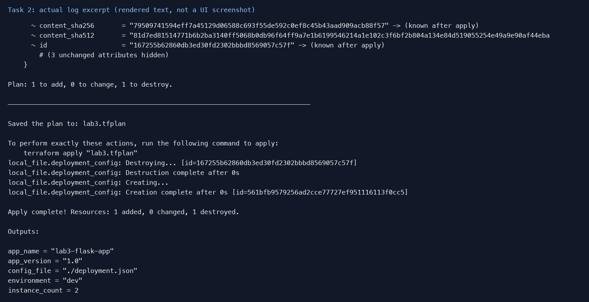

# Lab 3: Monitoring, Logging & DevSecOps

## Task 2: Provision infrastructure configuration with Terraform

Nirdesh Jain | Repository: github.com/jainnirdesh/DevOps | 18 November 2026

Platform: macOS (Apple Silicon), Docker context `colima-lab2`, shared network `lab3-network`. Commands below run from the `Lab 3` directory unless stated otherwise. Results describe the saved local execution on 18 November 2026.

## 1. Objective

Initialize, validate, plan, and apply the supplied Terraform infrastructure model, and inspect a scaling plan.

## 2. Configuration files

- [main.tf](../terraform/main.tf): `null_resource` server and instance simulations, plus `local_file` deployment configuration.
- [variables.tf](../terraform/variables.tf): application name, version, environment, instance count, and port.
- [outputs.tf](../terraform/outputs.tf): configuration path, simulated instance count, and separately deployed app URL.

The default environment is `dev`, the instance count is 2, and the app port is 5003.

```hcl
terraform {
  required_version = ">= 1.0"
  required_providers {
    null = {
      source  = "hashicorp/null"
      version = "~> 3.0"
    }
    local = {
      source  = "hashicorp/local"
      version = "~> 2.0"
    }
  }
}

provider "null" {}
provider "local" {}

# Simulate a "server" using a local null resource
resource "null_resource" "app_server" {
  triggers = {
    app_name    = var.app_name
    app_version = var.app_version
    environment = var.environment
  }

  provisioner "local-exec" {
    command = "echo Provisioning ${var.app_name} v${var.app_version} on ${var.environment} environment"
  }

  provisioner "local-exec" {
    when    = destroy
    command = "echo Destroying server for ${self.triggers.app_name}"
  }
}

# Simulate multiple scaled instances
resource "null_resource" "app_instances" {
  count = var.instance_count

  triggers = {
    instance_id = "instance-${count.index + 1}"
    app_name    = var.app_name
  }

  provisioner "local-exec" {
    command = "echo Started ${var.app_name} instance ${count.index + 1} of ${var.instance_count}"
  }
}

# Write a local deployment config file
resource "local_file" "deployment_config" {
  filename = "${path.module}/deployment.json"
  content = jsonencode({
    app_name    = var.app_name
    version     = var.app_version
    environment = var.environment
    instances   = var.instance_count
    port        = var.app_port
  })
}
```

## 3. Initialize, plan, and apply

```sh
terraform -chdir=terraform init
terraform -chdir=terraform validate
terraform -chdir=terraform plan -out=lab3.tfplan
terraform -chdir=terraform apply lab3.tfplan
terraform -chdir=terraform output
```

The apply completed and generated `terraform/deployment.json`. The application URL output is `http://localhost:5003`.

## 4. Verify repeatability and inspect scaling

```sh
terraform -chdir=terraform plan -detailed-exitcode
terraform -chdir=terraform plan -var=instance_count=3
```

The repeat plan reported **No changes**. A separate plan demonstrated the change from two to three simulated instances; that scaling plan was not applied.



Figure 2 — Terraform apply and outputs. Rendered from saved command output; this is not a browser screenshot.

Evidence: [execution transcript](../evidence/task2-terraform.log), [repeat plan](../evidence/task2-idempotence.log), [scaling plan](../evidence/task2-scale-plan.log).

## 5. Conclusion and scope

Terraform managed local configuration state successfully. This implementation is a **simulation using null and local providers**: it does not create cloud machines or run two application containers. Ansible deploys the separate Flask container.

## Execution status

Task 2: **PASS** for the local scope described above.

All reported outcomes are limited to the evidence retained in this folder. Setup and re-run instructions: [README.md](../README.md).
