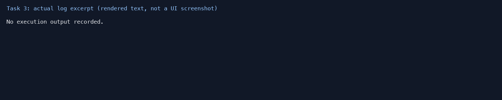

# Lab 3: Monitoring, Logging & DevSecOps

## Task 3: Implement centralized logging with ELK

Nirdesh Jain | Repository: github.com/jainnirdesh/DevOps | 18 November 2026

Platform: macOS (Apple Silicon), Docker context `colima-lab2`, shared network `lab3-network`. Commands below run from the `Lab 3` directory unless stated otherwise. Results describe the saved local execution on 18 November 2026.

## 1. Objective

Send real Flask request events through Logstash into Elasticsearch and make them searchable in Kibana.

## 2. Logging architecture

```text
Flask request -> JSON event -> lab3-logstash:5000
                                  |
                                  v
                       Elasticsearch:9200
                                  |
                                  v
                           Kibana:5601
```

All three ELK services use version `7.17.15`. The external Docker network `lab3-network` is created by Task 1. Host TCP port 5002 forwards to Logstash port 5000; the application connects directly over the shared network.

Configuration: [docker-compose.yml](../elk/docker-compose.yml), [logstash.conf](../elk/logstash.conf), and [application](../app/app.py).

```text
input {
  tcp {
    port => 5000
    codec => json
  }
  beats {
    port => 5044
  }
}

filter {
  if [type] == "flask" {
    grok {
      match => { "message" => "%{TIMESTAMP_ISO8601:timestamp} %{LOGLEVEL:level} %{GREEDYDATA:msg}" }
    }
  }
}

output {
  elasticsearch {
    hosts => ["http://elasticsearch:9200"]
    index => "lab3-logs-%{+YYYY.MM.dd}"
  }
  stdout {
    codec => rubydebug
  }
}
```

## 3. Start the stack

Run Task 1 first to create the shared network and deploy the app.

```sh
docker compose -p lab3-elk -f elk/docker-compose.yml up -d
docker compose -p lab3-elk -f elk/docker-compose.yml ps
curl -fsS http://localhost:9200/_cluster/health
```

The initial Logstash configuration used a 128 MB heap and failed with `OutOfMemoryError`. The corrected configuration uses `-Xms512m -Xmx512m`, one worker, batch size 50, and disables its unused internal monitoring pipeline.

## 4. Generate and verify logs

```sh
curl -fsS http://localhost:5003/
curl -fsS 'http://localhost:9200/lab3-logs-*/_search?q=service:lab3-flask'
python3 scripts/verify.py
```

The combined verification found 66 indexed application events in its saved response. It also confirmed Kibana's `green` health status and created the `lab3-logs-*` index pattern with `@timestamp` as the time field. Open [Kibana](http://localhost:5601), then Discover, to inspect the events.

A single-node cluster may report yellow after creating an index with a replica; the replica cannot be assigned to a second node in this lab.



Figure 3 — Combined verification of application logs and service health. Rendered from saved command output; this is not a browser screenshot.

Evidence: [stack startup](../evidence/task3-elk.log), [live responses](../evidence/live-verification.json), [initial heap error](../evidence/task3-logstash-initial-heap-error.log).

## 5. Conclusion

Real application events reached Elasticsearch through Logstash, and Kibana was available with the log index pattern configured.

## Execution status

Task 3: **PASS** for the local scope described above.

All reported outcomes are limited to the evidence retained in this folder. Setup and re-run instructions: [README.md](../README.md).
