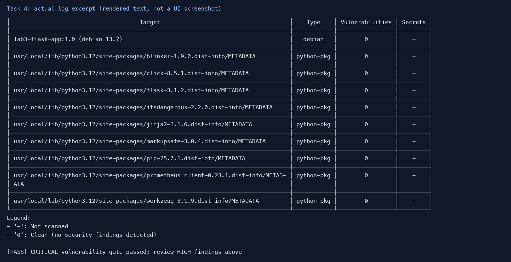

# Lab 3: Monitoring, Logging & DevSecOps

## Task 4: Integrate container security scanning into CI/CD

Nirdesh Jain | Repository: github.com/jainnirdesh/DevOps | 18 November 2026

Platform: macOS (Apple Silicon), Docker context `colima-lab2`, shared network `lab3-network`. Commands below run from the `Lab 3` directory unless stated otherwise. Results describe the saved local execution on 18 November 2026.

## 1. Objective

Scan the actual application image with Trivy and configure a Jenkins pipeline that blocks deployment when CRITICAL vulnerabilities are detected.

## 2. Execute the application-image scan

Task 1 must build `lab3-flask-app:1.0` before scanning.

```sh
bash devsecops/trivy_scan.sh lab3-flask-app 1.0
```

The [scan script](../devsecops/trivy_scan.sh) displays HIGH and CRITICAL findings, then runs a CRITICAL-only gate with `--exit-code 1`. Docker socket access lets Trivy inspect the locally built image. A named cache volume retains the vulnerability database. The first database download timed out; the successful retry used a 20-minute timeout.

## 3. Recorded findings

| Severity | Package findings |
| --- | ---: |
| HIGH | 48 |
| CRITICAL | 0 |

The CRITICAL gate passed. HIGH findings remain; this result does not mean that the image is free of vulnerabilities. Counts represent package findings, so a CVE affecting multiple packages can appear more than once.

Full evidence: [scan transcript](../evidence/task4-security.log) and [machine-readable findings](../evidence/task4-vulnerabilities.json).



Figure 4 — Trivy scan and CRITICAL gate result. Rendered from saved command output; this is not a browser screenshot.

## 4. Jenkins pipeline configuration

The pipeline enters `Lab 3` after checkout, builds a versioned image, executes feature flag tests, scans that same image, and deploys on the `main` branch. Deployment uses `build_image=false` so Ansible does not rebuild the scanned image. Jenkins Script Path: `Lab 3/devsecops/Jenkinsfile`.

```groovy
pipeline {
    agent any
    environment {
        IMAGE_NAME = 'lab3-flask-app'
        IMAGE_TAG = "${BUILD_NUMBER}"
    }
    stages {
        stage('Build') {
            steps {
                dir('Lab 3') {
                    sh 'docker build -t "$IMAGE_NAME:$IMAGE_TAG" app/'
                }
            }
        }
        stage('Feature flag tests') {
            steps {
                dir('Lab 3') {
                    sh '.venv/bin/python feature-flags/test_flags.py'
                }
            }
        }
        stage('Critical vulnerability gate') {
            steps {
                dir('Lab 3') {
                    sh 'bash devsecops/trivy_scan.sh "$IMAGE_NAME" "$IMAGE_TAG"'
                }
            }
        }
        stage('Deploy') {
            when { branch 'main' }
            steps {
                dir('Lab 3') {
                    sh '''
                        export DOCKER_HOST="$(docker context inspect --format '{{.Endpoints.docker.Host}}')"
                        .venv/bin/ansible-playbook -i ansible/inventory ansible/playbook.yml -e "app_tag=$IMAGE_TAG" -e build_image=false
                        docker compose -p lab3-elk -f elk/docker-compose.yml up -d
                        docker compose -p lab3-monitoring -f prometheus/docker-compose.yml up -d
                        .venv/bin/python scripts/verify.py
                    '''
                }
            }
        }
    }
}
```

## 5. Conclusion and execution scope

The local Trivy scan completed and its CRITICAL-only gate passed. The Jenkinsfile is prepared, but **no Lab 3 Jenkins server job or OWASP dependency-check run was executed**. Local scan execution and pipeline configuration are recorded separately.

## Execution status

Task 4: **PASS** for the local scope described above.

All reported outcomes are limited to the evidence retained in this folder. Setup and re-run instructions: [README.md](../README.md).
