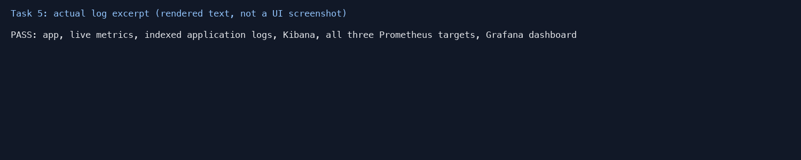

# Lab 3: Monitoring, Logging & DevSecOps

## Task 5: Set up monitoring with Prometheus and Grafana

Nirdesh Jain | Repository: github.com/jainnirdesh/DevOps | 18 November 2026

Platform: macOS (Apple Silicon), Docker context `colima-lab2`, shared network `lab3-network`. Commands below run from the `Lab 3` directory unless stated otherwise. Results describe the saved local execution on 18 November 2026.

## 1. Objective

Collect application and system-view metrics, verify scrape targets, and provision a Grafana datasource and dashboard.

## 2. Configure metrics and scraping

The Flask app exposes `/metrics` through `prometheus-client`. Its `lab3_http_requests_total` counter records actual requests by method, path, and response status. Prometheus scrapes the app every 10 seconds.

```yaml
global:
  scrape_interval: 15s
  evaluation_interval: 15s

scrape_configs:
  - job_name: "prometheus"
    static_configs:
      - targets: ["localhost:9090"]

  - job_name: "lab3-flask-app"
    static_configs:
      - targets: ["lab3-app:5000"]
    metrics_path: /metrics
    scrape_interval: 10s

  - job_name: "node-exporter"
    static_configs:
      - targets: ["node-exporter:9100"]
```

The three jobs are the application, Prometheus itself, and node-exporter. Node-exporter reports its Docker VM/container view, not native macOS host metrics.

## 3. Start monitoring services

Run Task 1 first to create `lab3-network` and deploy the app.

```sh
docker compose -p lab3-monitoring -f prometheus/docker-compose.yml up -d
curl -fsS http://localhost:9090/-/healthy
curl -fsS http://localhost:3000/api/health
curl -fsS http://localhost:9090/api/v1/targets
```

All three targets were **UP** in the saved execution. Grafana's database health was `ok`, and its provisioned Prometheus datasource health was `OK`.

## 4. Inspect the dashboard

Open [Prometheus targets](http://localhost:9090/targets) and the [Grafana dashboard](http://localhost:3000/d/lab3). Grafana local lab login: `admin` / `admin123`.

Provisioning files are in [prometheus/provisioning](../prometheus/provisioning). The dashboard contains four panels:

- Service availability: `up`.
- Total application requests: `sum(lab3_http_requests_total)`.
- Application request rate: `sum(rate(lab3_http_requests_total[1m]))`.
- CPU usage from node-exporter's available system view.

```sh
curl -fsS http://localhost:5003/
curl -fsS 'http://localhost:9090/api/v1/query?query=sum(lab3_http_requests_total)'
python3 scripts/verify.py
```



Figure 5 — Live application, Prometheus, and Grafana verification. Rendered from saved command output; this is not a browser screenshot.

Evidence: [startup transcript](../evidence/task5-monitoring.log), [Grafana checks](../evidence/grafana-verification.json), [combined live responses](../evidence/live-verification.json).

## 5. Conclusion

Application metrics were collected successfully, all three scrape targets were up, and Grafana's datasource and four-panel dashboard were verified.

## Execution status

Task 5: **PASS** for the local scope described above.

All reported outcomes are limited to the evidence retained in this folder. Setup and re-run instructions: [README.md](../README.md).
