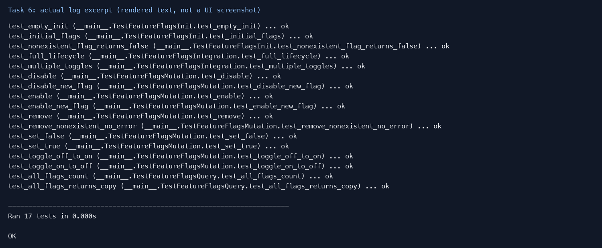

# Lab 3: Monitoring, Logging & DevSecOps

## Task 6: Implement feature flags and automated tests

Nirdesh Jain | Repository: github.com/jainnirdesh/DevOps | 18 November 2026

Platform: macOS (Apple Silicon), Docker context `colima-lab2`, shared network `lab3-network`. Commands below run from the `Lab 3` directory unless stated otherwise. Results describe the saved local execution on 18 November 2026.

## 1. Objective

Implement an in-memory feature flag store and verify its behavior with automated unit tests.

## 2. Feature flag implementation

[feature_flags.py](../feature-flags/feature_flags.py) implements `FeatureFlags` with methods to enable, disable, set, toggle, remove, and query flags. Unknown flags default to false. `all_flags()` returns a copy so callers cannot accidentally mutate the stored state.

```python
from feature_flags import FeatureFlags

flags = FeatureFlags({"dark_mode": False})
flags.enable("dark_mode")
assert flags.is_enabled("dark_mode")
flags.toggle("dark_mode")
assert not flags.is_enabled("dark_mode")
```

This example assumes execution from the `feature-flags` directory or that directory on Python's import path.

## 3. Execute the tests

```sh
.venv/bin/python feature-flags/test_flags.py
```

The [test suite](../feature-flags/test_flags.py) covers initialization, absent flags, enabling/disabling, explicit values, toggling in both directions, removal, snapshot copying, and a full lifecycle.

Recorded output:

```text
Ran 17 tests in 0.000s

OK
```



Figure 6 — All 17 feature flag tests passed. Rendered from saved command output; this is not a browser screenshot.

Full transcript: [task6-tests.log](../evidence/task6-tests.log).

## 4. Application behavior and scope

The Flask demo separately reads `FLAG_DARK_MODE` and `FLAG_BETA_UI` from its environment at startup. Its home endpoint displays these flag values. The tested `FeatureFlags` class is an independent in-memory module; no remote flag service, persistent storage, or live HTTP flag-management API was demonstrated.

## 5. Conclusion

All 17 supplied unit tests passed with no failures. The module supports controlled flag changes within the running Python process.

## Execution status

Task 6: **PASS** for the local scope described above.

All reported outcomes are limited to the evidence retained in this folder. Setup and re-run instructions: [README.md](../README.md).
