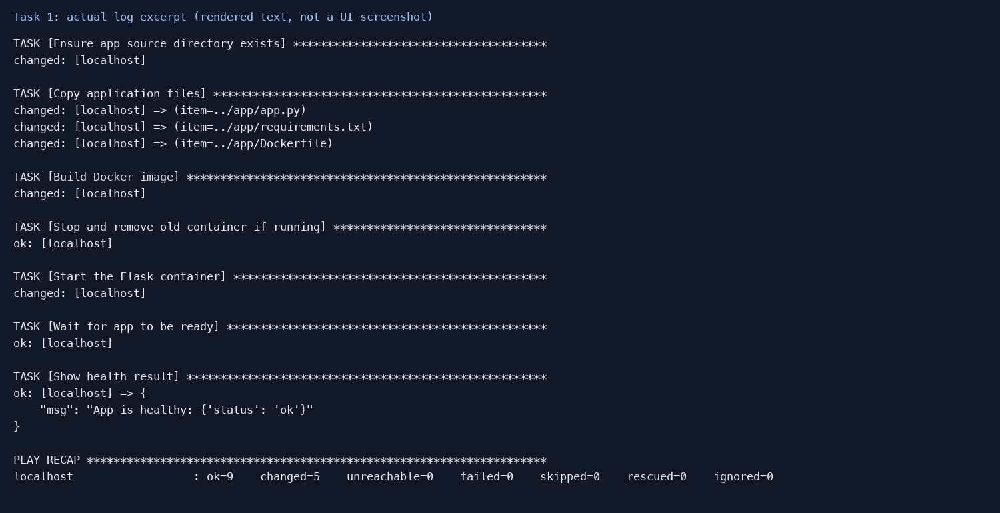
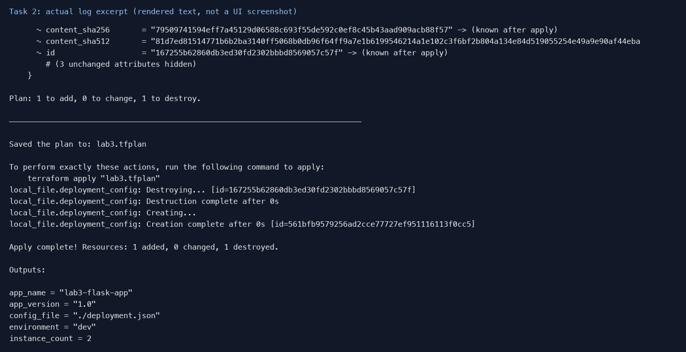
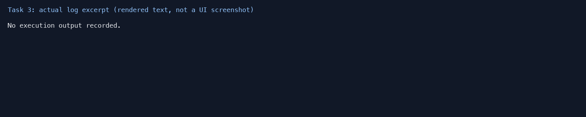
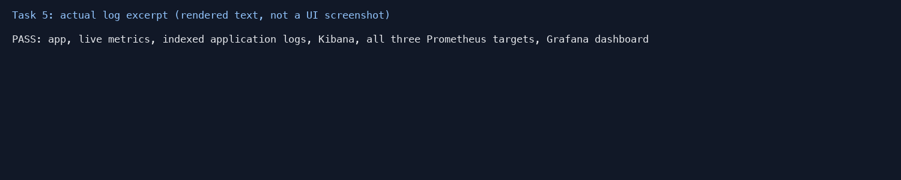
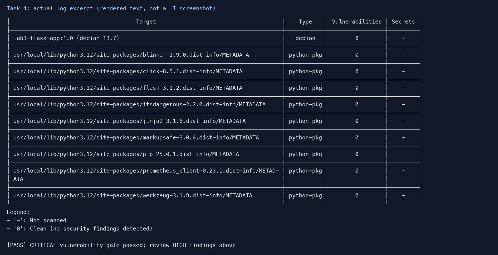
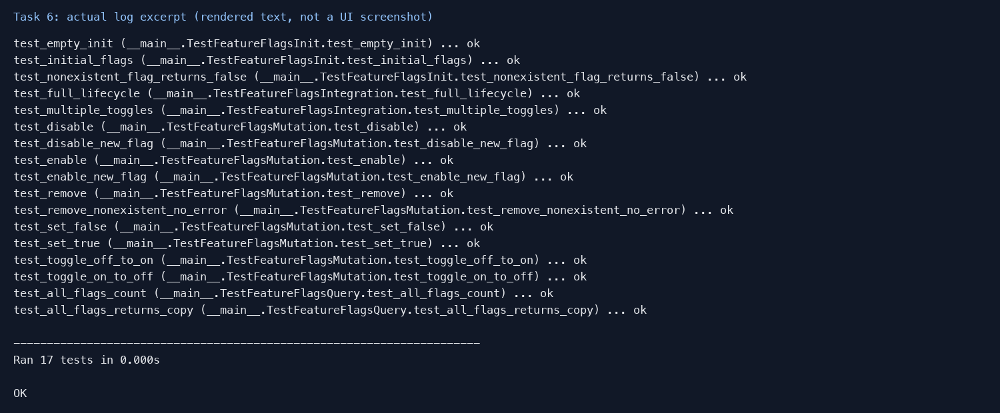

# Lab 3: Monitoring, Logging & DevSecOps

## Task 7: Monitoring, logging, and DevSecOps report

Nirdesh Jain | Repository: github.com/jainnirdesh/DevOps | 18 November 2026

Platform: macOS (Apple Silicon), Docker context `colima-lab2`, shared network `lab3-network`. Commands below run from the `Lab 3` directory unless stated otherwise. Results describe the saved local execution on 18 November 2026.

## 1. Objective

Summarize the architecture, verified outcomes, limitations, and evidence from the six implementation tasks.

## 2. Architecture

```text
Repository -> Jenkinsfile: Build -> Tests -> Trivy gate -> Deploy
              (configured; no Lab 3 Jenkins job executed)

Ansible -> Docker Flask application on localhost:5003
Terraform -> local simulated instance state + deployment.json

Flask JSON events -> Logstash -> Elasticsearch -> Kibana
Flask /metrics + node-exporter -> Prometheus -> Grafana
```

Ansible deploys the actual application container. Terraform manages the supplied local simulation. The application and observability services share `lab3-network`.

## 3. Task results

| Task | Recorded result | Scope |
| --- | --- | --- |
| 1. Ansible | PASS: 9 OK, 0 failed | Local image build, deployment, and health check |
| 2. Terraform | PASS: apply and repeat plan | Two simulated instances; scaling plan to three only |
| 3. ELK | PASS: actual request events indexed | Kibana healthy and log index pattern created |
| 4. Security | CRITICAL gate PASS | 48 HIGH package findings, 0 CRITICAL; Jenkins configured only |
| 5. Monitoring | PASS: all three targets UP | Grafana datasource and four-panel dashboard verified |
| 6. Feature flags | PASS: 17/17 tests | In-memory module; no remote flag service |

## 4. Infrastructure automation



Figure 1 — Ansible deployment. Rendered from saved command output; this is not a browser screenshot.



Figure 2 — Terraform local simulation and outputs. Rendered from saved command output; this is not a browser screenshot.

## 5. Centralized logging and monitoring

Flask request events were forwarded as JSON and indexed under `lab3-logs-*`. The retained combined verification response contained 66 matching application events. Logstash's initial 128 MB heap failed; a 512 MB heap and one worker allowed the pipeline to start successfully.

Prometheus collected actual application counters. All three scrape targets were up. Grafana's datasource health and four-panel dashboard were verified. Node-exporter provides a Docker VM/container system view.



Figure 3 — Indexed logs and combined health verification. Rendered from saved command output; this is not a browser screenshot.



Figure 5 — Prometheus and Grafana verification. Rendered from saved command output; this is not a browser screenshot.

## 6. Security and testing

Trivy scanned `lab3-flask-app:1.0` and reported 48 HIGH package findings and no CRITICAL findings. The configured gate blocks CRITICAL vulnerabilities; the HIGH findings remain recorded. The Lab 3 Jenkinsfile was prepared but not executed as a Jenkins server job.

The feature flag suite passed all 17 tests. Its in-memory flag class and Flask's startup environment flags are separate implementations.



Figure 4 — Trivy CRITICAL gate. Rendered from saved command output; this is not a browser screenshot.



Figure 6 — Feature flag tests. Rendered from saved command output; this is not a browser screenshot.

## 7. Access and reproduction

| Service | URL |
| --- | --- |
| Flask | http://localhost:5003 |
| Elasticsearch | http://localhost:9200 |
| Kibana | http://localhost:5601 |
| Prometheus | http://localhost:9090/targets |
| Grafana | http://localhost:3000/d/lab3 |

Grafana local lab credentials: `admin` / `admin123`.

After installing the prerequisites in [README.md](../README.md), run:

```sh
bash scripts/run.sh
```

The runner records actual command output and statuses. This report describes the saved execution; it does not assert that services remain running indefinitely.

## 8. Conclusion

Local application deployment, centralized log flow, metrics collection, dashboard provisioning, container scanning, and feature flag testing were demonstrated. Terraform's simulated provisioning, the configured-only Jenkins pipeline, and the remaining HIGH findings define the limits of this lab result.

Evidence: [results.json](../evidence/results.json), [live-verification.json](../evidence/live-verification.json), and [Trivy findings](../evidence/task4-vulnerabilities.json). Task-specific transcripts are linked in the individual reports.

## Execution status

Task 7: **PASS** for the local scope described above.

All reported outcomes are limited to the evidence retained in this folder. Setup and re-run instructions: [README.md](../README.md).
