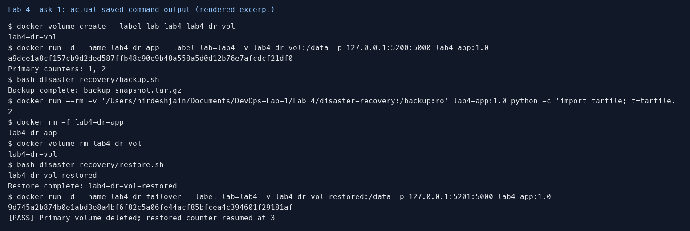

# Lab 4: Advanced Deployment Strategies & Enterprise DevOps

## Task 1: Design and demonstrate disaster recovery

Nirdesh Jain | 18 November 2026 | macOS Apple Silicon, Docker context `colima-lab2`

Commands run from `Lab 4`. Results belong to the saved local execution. Figures are rendered log excerpts, not GUI screenshots.

## 1. Objective

Protect Docker volume state using a verified backup and restore it after simulated loss of the original volume.

## 2. Procedure

1. Create `lab4-dr-vol` and start the primary application on loopback port 5200.
2. Make two requests and verify counters 1 and 2.
3. Create a compressed snapshot with `disaster-recovery/backup.sh` and verify its counter before deletion.
4. Remove only the experiment's primary container and volume.
5. Restore into `lab4-dr-vol-restored`, start failover on port 5201, and verify counter 3.

## 3. Commands

```sh
bash disaster-recovery/backup.sh
bash disaster-recovery/restore.sh
curl -fsS http://localhost:5201/health
```

## 4. Observations

The saved snapshot contained counter 2 and the first failover request returned counter 3. The archive SHA-256 and before/after responses are retained in [task1-recovery.json](../evidence/task1-recovery.json).

This proves recovery to the saved snapshot. Writes after a snapshot would not be recovered by this method. No automatic failover controller or production recovery-time objective was demonstrated. The runner refuses to overwrite pre-existing disaster-recovery volumes.



Full transcript: [task1.log](../evidence/task1.log).

## 5. Implementation files

- [disaster-recovery/backup.sh](../disaster-recovery/backup.sh)
- [disaster-recovery/restore.sh](../disaster-recovery/restore.sh)

## Execution status

**PASS**: Backup verified at counter 2; original volume deleted; failover resumed at 3. Recovery covers the saved snapshot.
