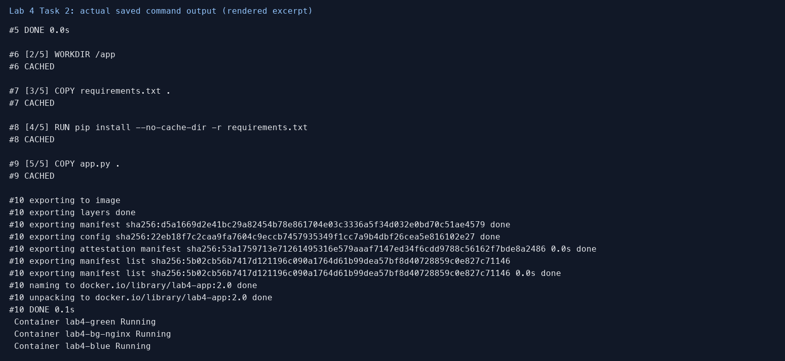

# Lab 4: Advanced Deployment Strategies & Enterprise DevOps

## Task 2: Implement automated testing in a CI/CD pipeline

Nirdesh Jain | 18 November 2026 | macOS Apple Silicon, Docker context `colima-lab2`

Commands run from `Lab 4`. Results belong to the saved local execution. Figures are rendered log excerpts, not GUI screenshots.

## 1. Objective

Run application tests as a quality gate before deployment and verify the deployed service.

## 2. Procedure

1. Build application images 1.0 and 2.0.
2. Execute seven pytest tests against the Flask application.
3. Retrieve credentials using a scoped Vault token and inject them into a child process.
4. Deploy the Blue-Green stack only after the previous stages succeed.
5. Verify `/health` through the reverse proxy.

## 3. Commands

```sh
bash ci-testing/run_pipeline.sh
.venv/bin/python -m pytest ci-testing/test_app.py -v --tb=short
```

## 4. Observations

The local shell pipeline passed all stages. **7 tests passed**, covering response status, message/version/hostname fields, health, and an unknown route. Each test uses a temporary state directory. `set -euo pipefail` propagates test failures and stops subsequent stages.

A Jenkinsfile is provided for an appropriately prepared local agent. The existing Jenkins server requires authentication, so no Lab 4 Jenkins server build or remote SCM execution is claimed. The successful evidence is from the local pipeline, which also verified on-demand secret injection.



Full transcript: [task2.log](../evidence/task2.log).

## 5. Implementation files

- [ci-testing/run_pipeline.sh](../ci-testing/run_pipeline.sh)
- [ci-testing/Jenkinsfile](../ci-testing/Jenkinsfile)
- [ci-testing/test_app.py](../ci-testing/test_app.py)

## Execution status

**PASS**: Local Build -> 7 pytest tests -> scoped Vault injection -> Deploy -> Verify pipeline passed. Jenkinsfile prepared; Jenkins server requires authentication and no server build is claimed.
