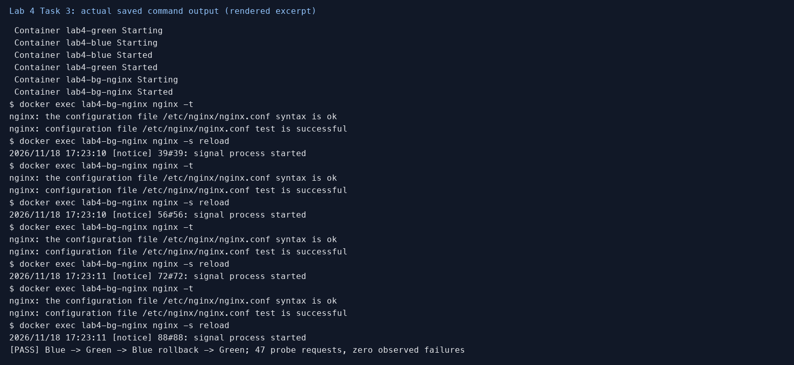

# Lab 4: Advanced Deployment Strategies & Enterprise DevOps

## Task 3: Implement Blue-Green deployment

Nirdesh Jain | 18 November 2026 | macOS Apple Silicon, Docker context `colima-lab2`

Commands run from `Lab 4`. Results belong to the saved local execution. Figures are rendered log excerpts, not GUI screenshots.

## 1. Objective

Run two application versions behind Nginx, verify traffic cutover, and demonstrate rollback.

## 2. Procedure

1. Start Blue (`1.0-blue`), Green (`2.0-green`), and the Nginx proxy on port 5300.
2. Confirm the initial Blue response.
3. Copy the Green upstream configuration, validate it with `nginx -t`, and reload Nginx.
4. Verify Green, roll back to Blue, then restore the final Green route.
5. Run HTTP probes throughout the switching sequence and retain every result.

## 3. Commands

```sh
docker compose -p lab4-bg -f blue-green/docker-compose.yml up -d
cp blue-green/nginx-green.conf blue-green/conf/default.conf
docker exec lab4-bg-nginx nginx -t
docker exec lab4-bg-nginx nginx -s reload
curl -fsS http://localhost:5300/
```

## 4. Observations

The saved run verified Blue -> Green -> Blue rollback -> Green. **47 HTTP probe requests had zero observed failures**. Both versions appeared in the probe sample. Final routing is Green.

Full samples: [task3-cutover.json](../evidence/task3-cutover.json). This finite local sample is evidence of the observed cutover, not a guarantee of zero downtime under every workload. Blue-Green needs parallel capacity; application schema compatibility and database migration were outside this demonstration.



Full transcript: [task3.log](../evidence/task3.log).

## 5. Implementation files

- [blue-green/docker-compose.yml](../blue-green/docker-compose.yml)
- [blue-green/nginx-blue.conf](../blue-green/nginx-blue.conf)
- [blue-green/nginx-green.conf](../blue-green/nginx-green.conf)

## Execution status

**PASS**: Cutover and rollback verified; 47 probe requests had zero observed failures. Final route: Green. This sample does not prove universal zero downtime.
