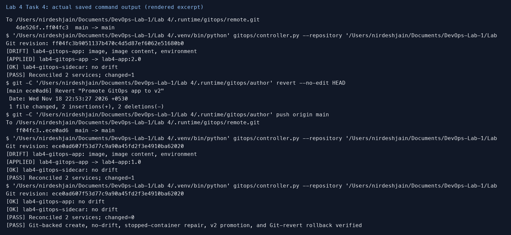

# Lab 4: Advanced Deployment Strategies & Enterprise DevOps

## Task 4: Implement Git-backed desired-state delivery

Nirdesh Jain | 18 November 2026 | macOS Apple Silicon, Docker context `colima-lab2`

Commands run from `Lab 4`. Results belong to the saved local execution. Figures are rendered log excerpts, not GUI screenshots.

## 1. Objective

Fetch versioned desired state from Git and reconcile local Docker containers, including drift and rollback.

## 2. Procedure

1. Create an isolated local bare Git remote and author/controller repositories under `.runtime/gitops`.
2. Commit the desired YAML and push to that local remote.
3. Fetch and check out its revision, then create the application and Nginx sidecar.
4. Reconcile again to confirm zero drift; stop the app and repair it in the next cycle.
5. Commit and push v2, reconcile, and verify the new app version.
6. Use `git revert`, push to the local remote, reconcile, and verify rollback to v1.

## 3. Commands

```sh
.venv/bin/python gitops/controller.py --repository "$PWD/.runtime/gitops/remote.git" --checkout "$PWD/.runtime/gitops/controller"
curl -fsS http://localhost:5500/
curl -I http://localhost:5501/
```

## 4. Observations

All six steps passed. The reconciler checks container ownership, running state, image reference/content, desired environment values, and loopback port mappings. It returns failure on Docker errors and fixes the Nginx sidecar's container port to 80.

The Git repositories and pushes are local sandbox resources; the user's main repository was not committed or pushed. Controller cycles were invoked explicitly. No hosted Git remote, Argo CD, Flux, or continuously polling controller was used. One instance per declared service is supported; unsupported replica counts are rejected.



Full transcript: [task4.log](../evidence/task4.log).

## 5. Implementation files

- [gitops/desired-state.yml](../gitops/desired-state.yml)
- [gitops/deploy.py](../gitops/deploy.py)
- [gitops/controller.py](../gitops/controller.py)

## Execution status

**PASS**: Isolated local Git remote: desired state fetched by revision, drift repaired, v2 promoted and Git revert rolled back to v1. Controller cycles invoked explicitly; no hosted GitOps controller.
