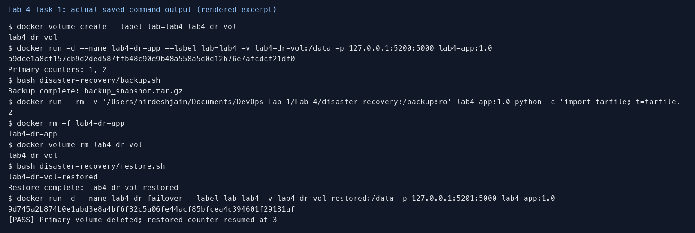
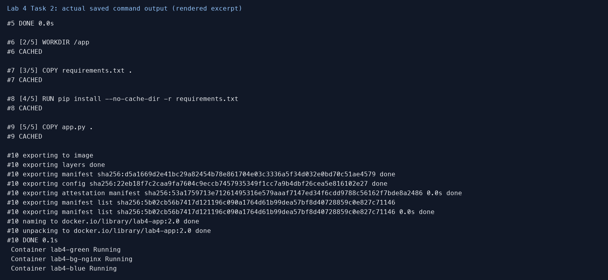
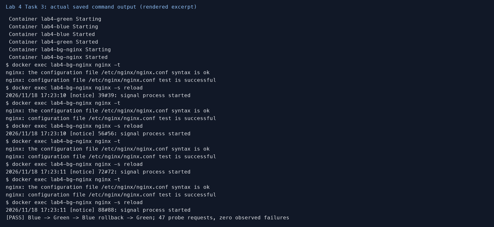
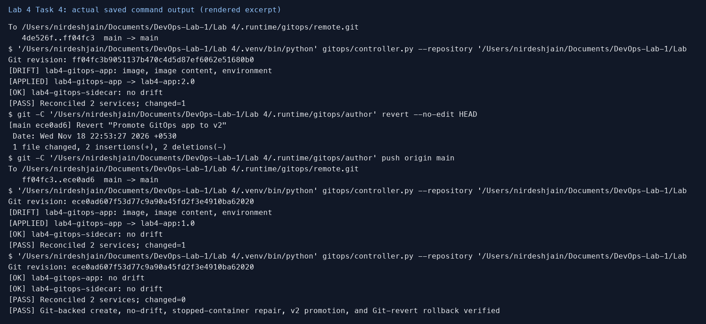
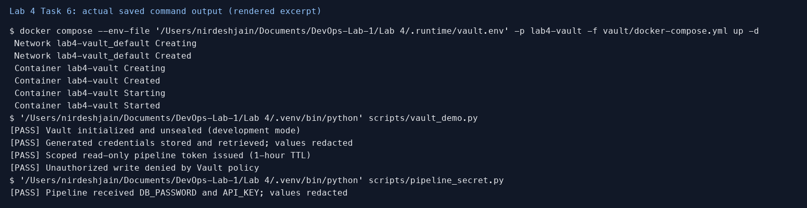
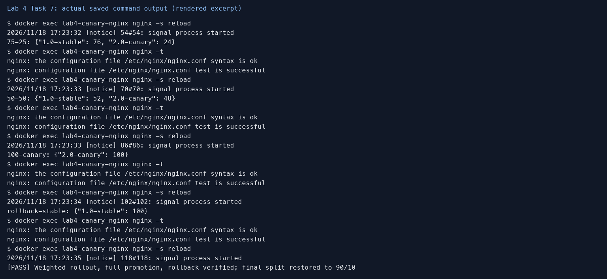

# Lab 4: Advanced Deployment Strategies & Enterprise DevOps

## Task 5: Advanced deployment strategies report

Nirdesh Jain | 18 November 2026 | macOS Apple Silicon, Docker context `colima-lab2`

Commands run from `Lab 4`. Results belong to the saved local execution. Figures are rendered log excerpts, not GUI screenshots.

## 1. Architecture

```text
Build -> Automated tests -> Vault injection -> Deploy -> Health verification
Blue v1 + Green v2 -> Nginx cutover and rollback
Stable v1 + Canary v2 -> Nginx weighted routing
Local Git remote -> fetched desired revision -> Docker reconciliation
Docker volume -> verified archive -> restored failover volume
```

## 2. Verified outcomes

| Task | Status | Observed scope |
| --- | --- | --- |
| 1 | PASS | Backup verified at counter 2; original volume deleted; failover resumed at 3. Recovery covers the saved snapshot. |
| 2 | PASS | Local Build -> 7 pytest tests -> scoped Vault injection -> Deploy -> Verify pipeline passed. Jenkinsfile prepared; Jenkins server requires authentication and no server build is claimed. |
| 3 | PASS | Cutover and rollback verified; 47 probe requests had zero observed failures. Final route: Green. This sample does not prove universal zero downtime. |
| 4 | PASS | Isolated local Git remote: desired state fetched by revision, drift repaired, v2 promoted and Git revert rolled back to v1. Controller cycles invoked explicitly; no hosted GitOps controller. |
| 6 | PASS | Generated credentials stored and read back; scoped read-only token injected credentials into a pipeline child process; unauthorized write denied. Vault dev mode is ephemeral and uses local HTTP. |
| 7 | PASS | 100-request samples verified 90/10, 75/25, 50/50, full canary promotion and stable rollback. Final configuration: 90/10. Requests are a local sequential sample. |

## 3. Strategy comparison

| Approach | Change mechanism | Demonstrated rollback | Main tradeoff |
| --- | --- | --- | --- |
| Blue-Green | Switch Nginx between parallel versions | Route back to Blue | Parallel application capacity |
| Canary | Adjust Nginx weights | Route all requests to stable | Sample-based checks; automatic policy not implemented |
| Git-backed delivery | Fetch a committed manifest and reconcile | Git revert followed by reconciliation | Controller cycles manually invoked |
| Disaster recovery | Backup and restore volume state | Restore a verified snapshot | Changes after the snapshot are outside recovery |

## 4. Execution evidence













## 5. Limitations and conclusion

The local pipeline passed seven tests and verified deployment. No Lab 4 Jenkins server job ran because the existing server requires authentication. Blue-Green had zero failures in 47 observed probes; this is a measured sample rather than a universal downtime guarantee. Canary checks used 100 requests at each stage. GitOps used an isolated local Git remote and explicit reconciliation cycles. Vault ran in ephemeral development mode over local HTTP with scoped read-only pipeline access. Disaster recovery restored the saved counter state, without claiming recovery of later writes.

All six implementation experiments passed within those local scopes. This seventh artifact documents the outcomes. Full statuses: [results.json](../evidence/results.json). Reproduction: [README.md](../README.md).
