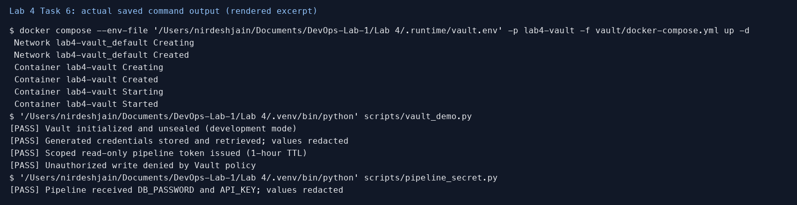

# Lab 4: Advanced Deployment Strategies & Enterprise DevOps

## Task 6: Implement secret management for the pipeline

Nirdesh Jain | 18 November 2026 | macOS Apple Silicon, Docker context `colima-lab2`

Commands run from `Lab 4`. Results belong to the saved local execution. Figures are rendered log excerpts, not GUI screenshots.

## 1. Objective

Store generated credentials in Vault and let the pipeline retrieve them with restricted read access.

## 2. Procedure

1. Start Vault on loopback port 8200 using a generated development token from an ignored local file.
2. Generate a database password and API key, write them to `secret/lab4/app`, and verify retrieval without printing values.
3. Create a policy that only reads `secret/data/lab4/app` and issue a token with a one-hour TTL.
4. Verify that the restricted token cannot write to an unauthorized path.
5. Fetch the credentials on demand and pass them as environment variables to a pipeline child process.

## 3. Commands

```sh
docker compose --env-file .runtime/vault.env -p lab4-vault -f vault/docker-compose.yml up -d
bash vault/init-vault.sh
.venv/bin/python scripts/pipeline_secret.py
```

## 4. Observations

Vault initialization, write/read verification, policy enforcement, and pipeline injection all passed. Evidence prints status and key names; credential values are redacted. Local token files have mode 0600 and are excluded from Git.

This is **Vault development mode**: storage is ephemeral, the local endpoint uses HTTP, and it is not a production Vault deployment. The pipeline token expires after one hour; repeat Task 6 to issue a fresh one. The environment file is used for the local dev server, while application credentials are retrieved from Vault.



Full transcript: [task6.log](../evidence/task6.log).

## 5. Implementation files

- [vault/docker-compose.yml](../vault/docker-compose.yml)
- [scripts/vault_demo.py](../scripts/vault_demo.py)
- [scripts/pipeline_secret.py](../scripts/pipeline_secret.py)

## Execution status

**PASS**: Generated credentials stored and read back; scoped read-only token injected credentials into a pipeline child process; unauthorized write denied. Vault dev mode is ephemeral and uses local HTTP.
