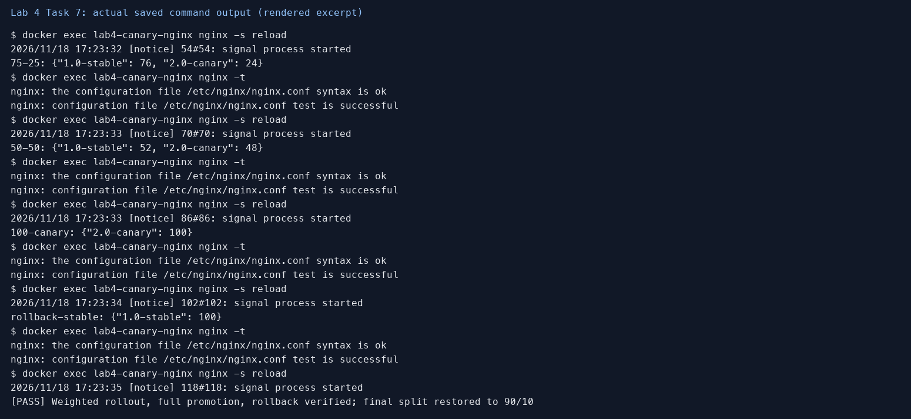

# Lab 4: Advanced Deployment Strategies & Enterprise DevOps

## Task 7: Implement a Canary deployment strategy

Nirdesh Jain | 18 November 2026 | macOS Apple Silicon, Docker context `colima-lab2`

Commands run from `Lab 4`. Results belong to the saved local execution. Figures are rendered log excerpts, not GUI screenshots.

## 1. Objective

Route weighted traffic to a new version, progressively promote it, and demonstrate stable rollback.

## 2. Procedure

1. Start stable v1, canary v2, and Nginx on loopback port 5400.
2. Configure upstream weights 9:1 and send 100 sequential requests.
3. Repeat with 3:1 and 1:1 weights.
4. Mark stable `down` to promote all traffic to canary.
5. Mark canary `down` to roll back all traffic to stable.
6. Restore the final 9:1 configuration.

## 3. Commands

```sh
docker compose -p lab4-canary -f canary/docker-compose.yml up -d
docker exec lab4-canary-nginx nginx -t
docker exec lab4-canary-nginx nginx -s reload
curl -fsS http://localhost:5400/
```

## 4. Observations

Each stage used 100 requests. Recorded distributions are below. Nginx round-robin worker behavior can produce small differences from nominal percentages in a finite sample. Zero is represented by `down`, since Nginx weights must be positive. Final routing is restored to 90/10.

These are local sequential requests, not a load test or automatic latency/error-driven rollout policy. Full counts are retained in [task7-distribution.json](../evidence/task7-distribution.json).

| Stage | Stable responses | Canary responses |
| --- | ---: | ---: |
| 90-10 | 90 | 10 |
| 75-25 | 76 | 24 |
| 50-50 | 52 | 48 |
| 100-canary | 0 | 100 |
| rollback-stable | 100 | 0 |



Full transcript: [task7.log](../evidence/task7.log).

## 5. Implementation files

- [canary/docker-compose.yml](../canary/docker-compose.yml)
- [canary/nginx-canary.conf](../canary/nginx-canary.conf)

## Execution status

**PASS**: 100-request samples verified 90/10, 75/25, 50/50, full canary promotion and stable rollback. Final configuration: 90/10. Requests are a local sequential sample.
